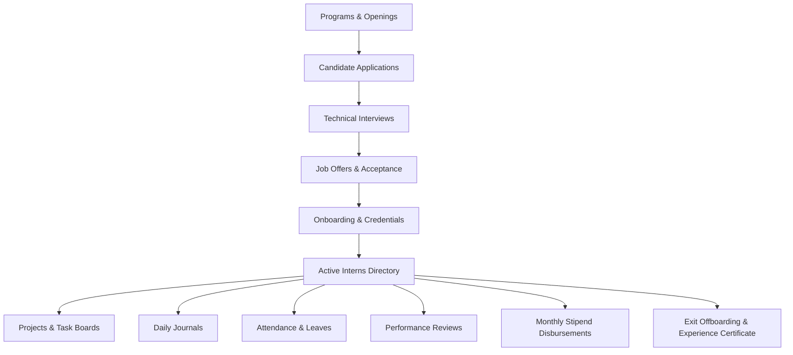
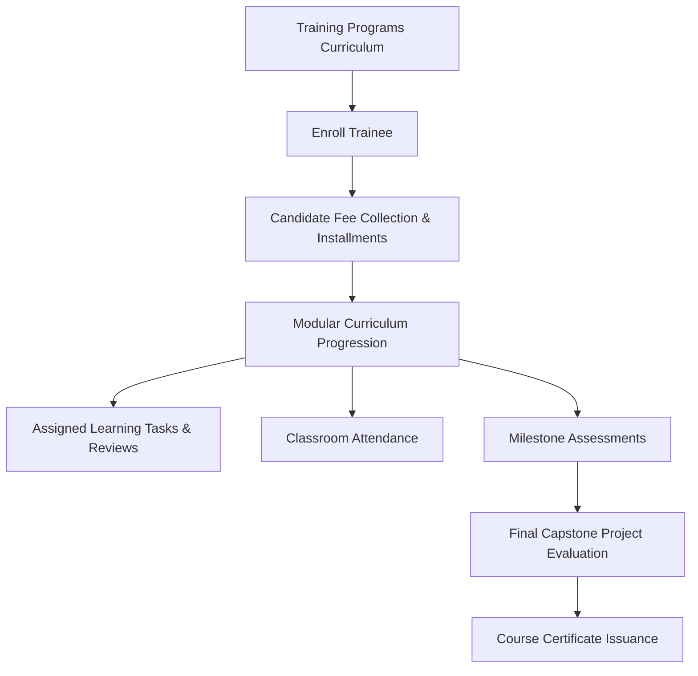

# TechMecha Torque — Intern Management System (IMS)
## Comprehensive Architecture, Operational Flow, and Schema Reference Guide

---

## 1. Executive Overview & System Architecture

The **Intern Management System (IMS)** is a multi-tenant enterprise platform built to manage technical talent through two distinct tracks:
1. **Regular Internships**: Sponsored or stipend-bearing organizational training aimed at operational work, projects, and recruitment pipeline conversion.
2. **Intern Traineeships**: Structured, modular training programs where candidates enroll in specialized curriculums, pay tuition fees, complete assignments, and graduate with capstone evaluations.

### 1.1 Technical Stack
- **Backend**: Node.js (ESM), Express.js modular monolith, Mongoose 8.x, MongoDB Atlas.
- **Frontend**: React 18, Vite 6, Tailwind CSS, Lucide icons, Headless UI components.
- **Authentication & Security**: Multi-tenant JWT (Access + Refresh tokens), HttpOnly cookies, RBAC permission middleware, PBKDF2/Bcrypt password hashing.
- **Media & Storage**: Cloudinary integration for resumes, portfolio attachments, and documents; local fallback.
- **Real-Time Collaboration**: Socket.IO for cross-departmental team messaging; Google Meet Hub for direct video conference provision.

---

## 2. Unwanted & Redundant Fields Audit (What Was Removed & Replaced)

To keep both management flows clean, intuitive, and professional, redundant and conflicting fields were systematically removed:

| Entity | Unwanted / Removed Fields | Replaced With / Correct Behavior | Rationale |
| :--- | :--- | :--- | :--- |
| **Training Program** (`TrainingProgramModal`) | • `Payment Status`<br>• `Amount Paid (₹)`<br>• `Remaining Balance` | • `Program Fee Model` (`PAID` / `FREE`)<br>• `Program Tuition Fee (₹)` | A **Training Program** is an educational curriculum. Payment statuses and balances belong to individual enrolled candidates, not the program definition. |
| **Intern Trainees** (`CreateTraineeModal` & `TraineeDetailPage`) | • `compensationType`<br>• `stipendAmount`<br>• `stipendFrequency`<br>• `Payroll Cycle`<br>• `Stipend Statements` | • `candidatePayment.feeAmount`<br>• `candidatePayment.amountPaid`<br>• `candidatePayment.paymentStatus`<br>• `candidatePayment.paymentMethod`<br>• `candidatePayment.paymentReference` (UTR)<br>• `Fee Collection & Payments` Ledger | Intern trainees do **not** receive stipends; they pay a tuition fee. Replacing stipend fields with candidate fee collection eliminates confusion. |
| **Internship Openings** (`OpeningModal`) | • `feeType: PAID`<br>• `feeAmount`<br>• `feeInclusions` | • `stipend` (display text)<br>• `stipendAmount` (₹ integer)<br>• Guaranteed 100% Free Application | Regular internship positions must not require fees from applicants; they offer stipends and professional experience. |
| **System Roles & Navigation** | • Artificial "Role Switcher" preview headers (`x-preview-role`) | • Strict, pure RBAC where Super Admin, Org Admin, and Staff see authentic organizational context | Eliminates UI desynchronization and ensures Super Admin and Org Admin share identical operational visibility. |
| **Trainee Workspace** | • `/intern/leaves`<br>• `/intern/onboarding`<br>• `/intern/exit`<br>• Payroll Statements | • `Curriculum & Tasks`<br>• `Documents & Verification`<br>• `Program Fee & Payments` (Receipts) | Trainees are students, not direct salaried employees; employee time-off and payroll cards were stripped out. |

---

## 3. Comparative Matrix: Regular Interns vs. Intern Trainees

```
+-----------------------------------------------------------------------------------------+
|                               INTERN MANAGEMENT SYSTEM                                  |
+-------------------------------------------+---------------------------------------------+
|        REGULAR INTERNSHIP TRACK           |          INTERN TRAINEE TRACK               |
+-------------------------------------------+---------------------------------------------+
| Purpose: Operational work & talent hiring | Purpose: Structured skill training & cohort |
| Financial: Organization PAYS Stipend      | Financial: Trainee PAYS Tuition Fee         |
| Flow: Openings -> Apps -> Offer -> Intern | Flow: Program -> Enroll -> Fee Ledger       |
| Supervision: Mentors & Project Managers   | Supervision: Instructors & Trainers         |
| Daily: Standups, Tasks, Journals          | Daily: Modules, Coding Tasks, Attendance    |
| Evaluation: Performance Reviews (1-5)     | Evaluation: Assessments & Capstone Project  |
| Completion: Experience Letter & Cert      | Completion: Course Completion Certificate   |
+-------------------------------------------+---------------------------------------------+
```

---

## 4. End-to-End Operational Workflows

### Flow A: Regular Internship Management (`INTERNSHIP MANAGEMENT`)



1. **Programs & Openings (`/admin/programs`)**:
   - Create an opening specifying: Title, Department, Description, Responsibilities (one per line), Required Skills, Preferred Skills, Work Mode (`REMOTE`, `HYBRID`, `ON_SITE`), Location, Open Positions, Stipend (₹), and Apply By Date (`YYYY-MM-DD` or `DD-MM-YYYY`).
   - Automatically publishes to the public careers portal (`/openings/public`).
2. **Applications & Screening (`/admin/applications`)**:
   - Candidates submit applications anonymously with resume uploads.
   - Recruiters screen, short-list, or reject candidates.
3. **Interviews (`/admin/interviews`)**:
   - Schedule interview rounds (Technical, HR, Managerial) with date/time, interviewer assignments, and meeting links.
4. **Offers (`/admin/offers`)**:
   - Generate offer letters with designated stipend, start date, and response deadline.
5. **Onboarding (`/admin/onboarding`)**:
   - When an offer is accepted, the system auto-provisions user credentials, assigns an `INT-...` ID, and kicks off document verification.
6. **Active Intern Execution**:
   - **Projects (`/admin/projects`)**: Assign to real organizational repositories and Kanban boards.
   - **Tasks & Reviews (`/admin/tasks`)**: Track deliverables with status approval workflows.
   - **Daily Journals (`/admin/journals`)**: Interns submit daily logs; mentors review and sign off.
   - **Attendance (`/admin/attendance`)**: Clock-in/clock-out tracking with 80% threshold compliance.
   - **Leaves (`/admin/leaves`)**: Formal time-off request and approval process.
7. **Performance & Appraisal (`/admin/performance`)**:
   - Multi-stage appraisal: Intern Self-Assessment -> Mentor Technical Evaluation -> Final HR decision.
8. **Finance & Stipends (`/admin/finance`)**:
   - Auto-calculate payable days from approved attendance and leaves.
   - Disburse monthly stipends with transaction reference (UTR) and downloadable PDF payslips.
9. **Exit & Offboarding (`/admin/exits`)**:
   - Clearance checklists (IT asset returns, access revocation, exit interview).
   - Instant cryptographic certificate generation (`CERT-...`) with public verification portal.

---

### Flow B: Intern Trainee Management (`INTERN TRAINEE MANAGEMENT`)



1. **Training Programs (`/admin/trainees?tab=programs`)**:
   - Staff define curriculums: Program Title, Code, Duration (e.g. 12 Weeks), Learning Mode, Lead Trainer, Capacity, and **Program Tuition Fee (₹)**.
2. **Trainee Enrollment (`/admin/trainees`)**:
   - Enroll candidate: First Name, Last Name, Email, Phone, College/University, Degree, Graduation Year, Start Date, Expected End Date, Assigned Mentor, and Initial Fee Payment details.
   - Auto-generates unique Trainee ID (`TRN-...`) and secure temporary login credentials.
3. **Fee Collection & Payments Ledger (`/admin/trainees?tab=payments`)**:
   - Dedicated financial tab displaying:
     * **Total Fees Billed (₹)**
     * **Total Fees Collected (₹)**
     * **Outstanding Balance Due (₹)**
     * **Settled / Cleared Trainees Count**
   - Filter by Program and Payment Status (`PENDING`, `PARTIAL`, `PAID`, `WAIVED`, `OVERDUE`).
   - Action **"Update Fee"** opens the fee ledger modal to record cash, UPI, bank transfer, or card payments with UTR reference numbers.
4. **Curriculum Modules & Tasks**:
   - Trainees view syllabus modules, submit GitHub repo and live demo URLs for review, and receive instructor feedback.
5. **Class Attendance & Assessments**:
   - Log attendance records with duration (minutes).
   - Record quiz and test scores with pass/fail marks.
6. **Final Capstone Project & Certification**:
   - Trainees submit their final capstone project.
   - Upon completion, instructors issue a certified training certificate.

---

## 5. Sidebar Navigation Reference

| Group | Menu Item | Route | Target Roles |
| :--- | :--- | :--- | :--- |
| **Operations** | Dashboard | `/admin/dashboard` | Admins, HR, Mentors |
| | Analytics | `/admin/analytics` | Super Admin, Org Admin, HR |
| | Team Chat | `/chat` | All authenticated users |
| **Bootcamps** | Google Meet Hub | `/admin/google-meet` | Admins, Trainers, Mentors |
| **Internship Management** | Programs & Openings | `/admin/programs` | Admins, HR |
| | Applications | `/admin/applications` | Admins, HR |
| | Interviews | `/admin/interviews` | Admins, HR, Interviewers |
| | Offers | `/admin/offers` | Admins, HR |
| | Onboarding | `/admin/onboarding` | Admins, HR |
| | Interns Directory | `/admin/interns` | Admins, HR, Mentors |
| | My Mentees | `/mentor/dashboard` | Mentors |
| | Projects | `/admin/projects` | Admins, Mentors, Interns |
| | Tasks & Reviews | `/admin/tasks` | Admins, Mentors, Interns |
| | Daily Journals | `/admin/journals` | Admins, Mentors, Interns |
| | Meetings | `/admin/meetings` | Admins, Mentors, Interns |
| | Attendance | `/admin/attendance` | Admins, Mentors |
| | Leave Requests | `/admin/leaves` | Admins, HR, Mentors |
| | Learning Paths | `/admin/learning` | Admins, Mentors, Interns |
| | Performance | `/admin/performance` | Admins, HR, Mentors |
| **Finance & Documents** | Finance & Stipends | `/admin/finance` | Super Admin, Org Admin, Finance |
| | Letters & Documents | `/admin/documents` | Admins, HR |
| | Document Templates | `/admin/templates` | Admins, HR |
| | Certificates | `/admin/certificates` | Admins, HR |
| | Exit & Offboarding | `/admin/exits` | Admins, HR |
| **Intern Trainee Management**| Training Programs | `/admin/trainees?tab=programs` | Admins, Trainers |
| | Trainees Directory | `/admin/trainees` | Admins, Trainers |
| | Fee Collection & Payments | `/admin/trainees?tab=payments` | Admins, Finance, Trainers |
| | Capstone Projects | `/admin/projects` | Admins, Trainers |
| | Tasks & Reviews | `/admin/tasks` | Admins, Trainers |
| | Daily Journals | `/admin/journals` | Admins, Trainers |
| | Sessions & Meetings | `/admin/meetings` | Admins, Trainers |
| | Class Attendance | `/admin/attendance` | Admins, Trainers |
| | Curriculum & Learning | `/admin/learning` | Admins, Trainers |
| | Assessments & Grades | `/admin/performance` | Admins, Trainers |
| | Letters & Documents | `/admin/documents` | Admins, Trainers |
| | Course Certificates | `/admin/certificates` | Admins, Trainers |

---

## 6. Verification and Test Results Summary

The system has undergone full automated test suites verifying all backend routes, database constraints, and user flows:

1. **Jest Backend Test Suite (`server/tests/api.test.js`)**:
   - **17 / 17 Tests Passed (100% Success)** in `10.48s`.
   - Verified: Health checks, HR Admin authentication, Intern authentication, RBAC authorization blocks, public openings ATS, certificate verification, intern dashboard metrics, MongoDB analytics aggregation, finance stipend generation, leave management, IT asset inventory, document template rendering, exit offboarding, role privilege escalation defenses, and Google Meet integration protections.

2. **Live End-to-End Flow Verification (`verify_all_flows.js`)**:
   - **29 / 29 Endpoints Passed (100% Success)**.
   - Verified live database operations covering recruitment, application processing, interview scheduling, offer generation, onboarding, intern timeline, task boards, certificates, and multi-tenant department access.

3. **Field Validation Verification (Venkat & Asrith Test Run)**:
   - **Opening Creation**: Tested exact user input (`title: "adfhg"`, `deadline: "21-11-2026"`, `workMode: "Remote"`). Returned **HTTP 201 Created** (`6ad910160e42b95a9656baed`).
   - **Training Program Creation**: Tested Asrith program (`title: "Asrith Training Program"`, `fee: ₹5,000`). Cleanly saved without requiring payment status or amount paid.
   - **Trainee Enrollment**: Enrolled Venkat (`TRN-2026-000002`) with partial fee payment (`₹2,000` paid of `₹5,000`).
   - **Trainee Fee Clearance**: Settled outstanding balance (`₹3,000`) with transaction reference `UPI-VENKAT-FINAL`, updating status to `PAID` with `₹0` balance.

4. **Production Build Compilation**:
   - Client bundle built with Vite in **13.39s** with zero syntax or bundling errors.
   - Server syntax validated (`node -c`) with zero warnings or errors.
